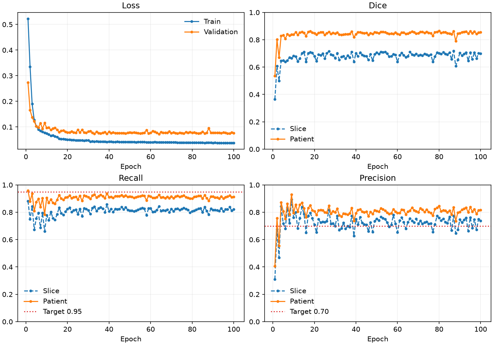
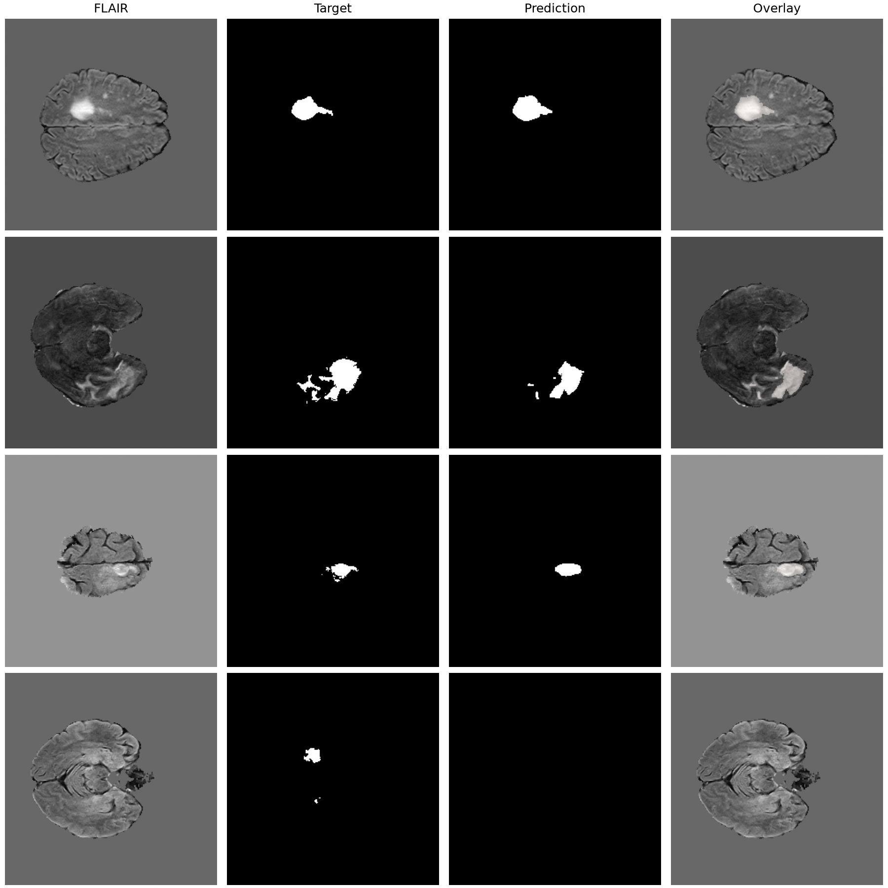
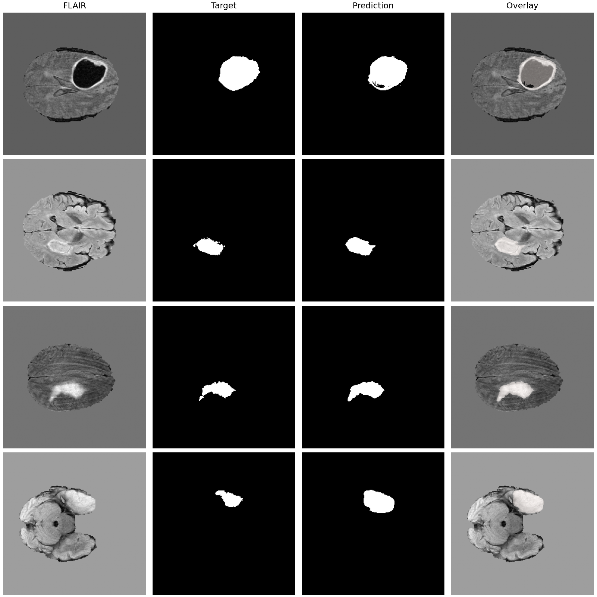

# Published results

Training completed 100 epochs. The selected model is epoch 64, with the lowest validation
loss in the final loss configuration. All reported metrics use threshold 0.5.

## Run configuration

| Setting | Value |
| --- | --- |
| Dataset | 335 BraTS patients; 268 training, 33 validation, 34 test |
| Preprocessed shape | 240 × 240 × 144 |
| Voxel spacing | 1 × 1 × 1 mm |
| Model | Binary 2D U-Net; 31,036,481 parameters |
| Optimizer | AdamW; final-stage learning rate 0.000001; weight decay 0.00001 |
| Scheduler | ReduceLROnPlateau; factor 0.5, patience 1, minimum rate 0.000001 |
| Final loss | Equal Tversky + BCE; FP weight 0.15, FN weight 0.85, positive BCE weight 2 |
| Batch size / seed | 16 / 42 |
| Epochs | 100 cumulative; 70 in the final loss configuration |
| Selected checkpoint | `best.pt`, epoch 64, lowest final-stage validation loss |
| Resume checkpoint | `latest.pt`, completed epoch 100 |
| Learning rate at selected epoch | 0.000001 |
| Validation loss | 0.072894 |
| Prediction threshold | 0.50 |

`metrics.json` and `metrics.png` cover epochs 1–100. `run.json` records the final configuration
and its 70 epochs, numbered 31–100. Both checkpoint files are available locally and ignored by Git.

| Epochs | Tversky FP weight | Tversky FN weight |
| --- | ---: | ---: |
| 1–15 | 0.30 | 0.70 |
| 16–30 | 0.20 | 0.80 |
| 31–100 | 0.15 | 0.85 |

Each loss change retained model weights and reset the optimizer, scaler, scheduler and best-loss
tracking. Loss values across these stages are not directly comparable; patient splits stayed fixed.

## Validation and test metrics

Both splits were evaluated with the selected epoch-64 model. Patient scores average metrics
computed over each patient's volume; slice scores average individual slices.

| Split | Scope | Dice | IoU | Recall | Precision |
| --- | --- | ---: | ---: | ---: | ---: |
| Validation | Slice | 0.673384 | 0.594826 | 0.842177 | 0.680093 |
| Validation | Patient | 0.842753 | 0.737808 | 0.926838 | 0.784222 |
| Test | Slice | 0.663546 | 0.586830 | 0.845390 | 0.665887 |
| Test | Patient | 0.856881 | 0.757431 | 0.936557 | 0.802112 |

Patient-wise validation precision passes the project requirement; recall remains below target.
Checks use strict comparisons on unrounded values.

| Recall > 0.95 | Precision > 0.70 |
| --- | --- |
| FAIL | PASS |

The comparison images show predictions from the same checkpoint on validation and test samples.

